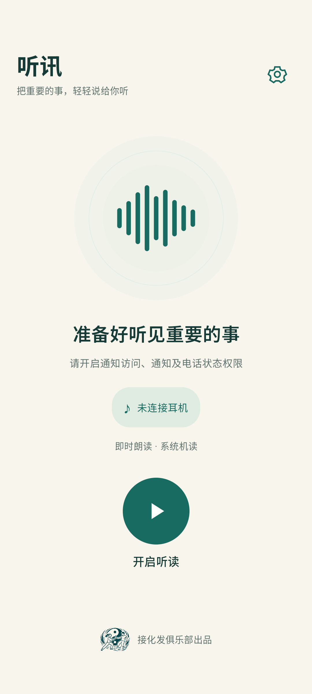

# 听讯 TingXun

戴上耳机，把重要通知听进耳朵里。支持 Android 11 及以上，无需自建服务器。

**接化发俱乐部出品**

[下载安卓安装包](https://github.com/yingling686/notification-reader-android/releases/latest) · [更新记录](CHANGELOG.md) · [0.1.12 测试记录](delivery/测试记录-0.1.12.md)

## 功能

- 即时朗读、定时合并、AI 定时摘要、重要规则即时读＋其余摘要四种内容模式。
- 系统离线中文机读，或 MiniMax / OpenAI 兼容 AI 合成语音；内容模式与声音独立选择。
- 用户开启听读会话后，支持后台和息屏处理，确认耳机输出后才发声。
- 可选仅息屏播报、整点报时，以及整点回顾上一小时的重要通知。
- 自选通知应用与应用内关键词规则，提供语速、免打扰、暂停、补读和清空。
- 米白与深青绿首页，右上角集中设置，内置通知自检、声音刷新与精简诊断。

AI 功能默认关闭，摘要与语音分别授权，接口和 API Key 由用户配置。兼容性受手机系统、通知内容可见性、TTS 引擎和厂商后台策略影响。

<p></p>

当前版本 **0.1.12 / versionCode 13**，修复一加/OPPO 引擎把中文标为 `chn` 时误报缺少离线语音包的问题。已通过 69 项单元测试、3 项 API 37 定向回归和 Lint；该厂商引擎修复后的实际出声仍待实机确认。

## 安装与开启

1. 从 [Releases](https://github.com/yingling686/notification-reader-android/releases/latest) 下载并安装 `听讯-0.1.12.apk`。已有版本直接覆盖安装，不要卸载，以保留应用选择、规则、接口配置、密钥与记录。
2. 首页右上角齿轮 → **应用与重要规则**，选择需要听的应用；默认不选任何应用。
3. 设置 → **权限与后台运行**，开启通知访问，允许通知与电话状态权限。电话状态仅用于通话时暂缓，不读取号码或通讯录。红米如提示受限设置，先到应用信息中允许受限设置。
4. 同页检查后台设置：红米 / HyperOS 允许后台运行、电池策略选择“无限制”、开启自启动。具体入口以手机系统为准。
5. 设置 → **内容与定时** 选择模式；要实时听消息选择“即时朗读”。定时间隔提供 1 / 3 / 5 / 10 / 15 / 30 分钟，默认 5 分钟，只影响定时模式。
6. 设置 → **声音与语速** 选择系统机读或 AI 合成语音。AI 需要先在 **AI 服务配置** 中分别配置、授权并通过相应测试；首页不再放声音设置。
7. 连接耳机，回首页点击一次 **开启听读**。开启后可退到桌面、其他应用或锁屏，消息自动处理，无需点击媒体播放按钮。声纹仅表达状态，不使用麦克风。
8. **播报记录与待播** 提供现在播报、跳过、补读和清空；**会话控制** 提供停止会话。暂停后的旧消息、断连期间积压仍需确认补读。
9. 后台异常可从 **诊断与设备** 复制诊断。诊断不包含通知正文、联系人、音频或密钥。

手机重启或应用被强行停止后，需重新开启听读。厂商冻结进程、通知本身延迟或隐藏正文时，应用无法保证准时读出。短间隔使用前台会话计时，空闲时不持续持有唤醒锁。

## 四种模式

| 模式 | 内容 |
| --- | --- |
| 即时朗读 | 新通知进入后依次朗读应用、通知标题和正文 |
| 定时朗读 | 合并本轮新增通知，同一应用及会话内容合并 |
| AI 定时摘要 | 优先需要回复、待办、会议/时间变更、异常提醒；无重要内容不读 |
| 混合模式 | 命中指定应用内的联系人/群名/关键词则即时读，其余定时摘要 |

摘要或混合模式需要先填写摘要密钥并开启摘要授权。联系人按通知实际文字匹配，不读取通讯录；系统或微信隐藏发送人/正文时，无法准确匹配和总结。

通知更新会去重；会话通知仅处理会话消息中的新增内容。即时消息不会再进入摘要。同一条通知状态变化导致内容改变时，可能作为新内容处理。仅处理开启会话后的通知；持续状态、分组摘要和听讯自身通知不处理。普通通知保存正文最多 9,000 字符，单条朗读正文最多 3,000 字符，超长会提示查看原应用。

## 两种声音

**系统机读（默认）**：只选择系统引擎标记为离线的中文声音。缺少语音包时到系统“文字转语音”下载中文离线包。声音列表和语速可在设置中调整；系统引擎由你选择的 TTS 服务提供。

**AI 合成语音**：在设置中选择 MiniMax 或 OpenAI 兼容接口，填写单独的语音密钥并保存配置，然后主动授权。开启会话并连接耳机后，点击“连接测试并试听”。测试完成且可播放后，“声音与语速”中才允许选用 AI 语音。测试使用固定文字，不会回退为机读，以免误报云端连接成功。

默认开启“AI 语音失败改用机读”。只回退未播的当前段；系统机读也不可用时保持待补读。每段最长 1,000 字符，按句切分，完整合成一段再播放。每段最多等待 30 秒、音频最多 10 MB。

## MiniMax 配置

### 内容摘要

- 完整地址：`https://api.minimax.cn/v1/chat/completions`
- 模型：`MiniMax-M3.1-Flash-Preview`
- 思考深度：`low`，不关闭模型思考；仅提取最终正文，过滤思考内容。
- 默认输出目标约 100～150 汉字。每轮最多 50 条、12,000 字符，超限分轮处理。
- M3.1 需要对应 M Plan / MiniMax Code 权限，语音 Key 不一定能调用。保存后用“连接测试”检验。
- 可替换为其他兼容 Chat Completions 的完整 HTTPS 地址和模型；响应应包含 `choices[0].message.content`。模型不可用时不会自动换模型。
- 模型需按提示返回包含 `important` 和 `summary` 的 JSON，格式异常保留队列，不直接读出异常返回内容。

### 语音

- 地址：`wss://api.minimax.cn/ws/v1/t2a_v2`
- 模型：`speech-2.8-turbo`
- 音色：`male-qn-qingse`，可填写其他可用 voice ID
- 格式：MP3 / 32 kHz / 单声道
- 通过 `connected_success → task_start → task_started → task_continue → task_finish → task_finished` 协议生成音频，按顺序解码并拼接 Hex 音频片段。

两项 Key 分别保存，允许用户自行填相同值，但各自权限必须单独测试。API Key 经 Android Keystore AES-GCM 加密，不提供导出或回显。修改语音接口、模型、音色或密钥后，需重新测试。

官方文档：[摘要接口](https://platform.minimax.cn/docs/api-reference/text-openai-api)、[WebSocket 语音](https://platform.minimax.cn/docs/api-reference/speech-t2a-websocket)。接口可用性、权限和费用由 MiniMax 决定。

## OpenAI 兼容接口

在设置中分别将摘要或语音的接口类型切换为“OpenAI 兼容接口”，两者可混搭不同服务商。填入服务商提供的 HTTPS Base URL，例如 `https://api.openai.com/v1`；也可填写完整端点。

- 摘要自动补全 `/chat/completions`，文本模型名需要自行填写。默认发送 `max_tokens=4096`；服务商或推理模型需要时，改选 `max_completion_tokens`，也可选择不发送长度参数。不会携带 MiniMax 的专用思考参数。
- 语音自动补全 `/audio/speech`，发送 `model`、`input`、`voice`、`response_format=mp3` 和 `speed`。预填模型 `gpt-4o-mini-tts`、音色 `alloy`，使用第三方服务时需换成对方支持的模型和音色。
- 仅域名自动补 `/v1`；自定义路径如 `https://example.com/proxy/v1` 会保留原路径；完整端点不会重复追加。
- 使用 Bearer API Key 认证；当前不实现 Responses 协议、Azure 专有鉴权或其他自定义请求格式。
- MiniMax 与通用接口分别加密保存摘要/语音密钥及配置。切换类型或修改服务地址后授权失效，语音需重新测试；不会自动换服务商或复制已有密钥。
- 两类提供商共用各自的“摘要 / 语音”每日请求上限，切换类型不会重置计数。

官方规范：[Chat Completions](https://developers.openai.com/api/reference/resources/chat/subresources/completions/methods/create)、[Speech](https://developers.openai.com/api/reference/resources/audio/subresources/speech/methods/create)。兼容服务需自行支持对应端点，不是所有提供聊天的服务也提供语音。

## 暂停、补读与失败处理

- 摘下/断开耳机、通话、音频焦点丢失、免打扰开始、设置修改：停止正在处理的播报，积压转为“待确认补读”。重新连接耳机或恢复后，不突然补读旧内容；新通知仍按当前模式处理。
- “确认补读积压消息”会把仍在所选应用范围内的积压消息重新加入队列。已经完成的音频段不重播，中断中的一段会从该段开头重读。
- “现在播报”处理当前可播的新增内容；待确认的旧消息需先确认补读。
- “跳过本次”跳过当前合并播报所含的消息，可能包含多条通知；“清空待播”停止并跳过全部待播。
- 摘要网络、限流、服务端错误在下一轮最多自动重试一次。鉴权失败暂停自动摘要，保存修正配置后再测试和补读。
- 耳机路由不明确、电话状态权限未授予或系统 TTS 不可用时，不播放。
- 音乐播放时申请短暂音频焦点，允许其他播放器压低音量；无法取得焦点则暂缓。
- 播放前焦点被拒绝或延迟时，沿用同一份合成文件，在 1 / 3 / 8 秒后最多重试三次，不增加合成请求。重试耗尽只保留受影响批次待确认；通话、断连、暂停和清空取消重试。已经出声后丢失焦点不会自动重播该段。

## 用量与隐私

云端摘要和语音默认关闭，需要分别确认。摘要发送选定应用的通知；云端语音发送待播文字，直接读通知时包括通知原文。关闭摘要不等于关闭 AI 语音，两项授权需独立管理。

每天摘要、语音分别默认最多 300 次请求，允许调整为 1～10,000。每个语音段计一次；连接测试、失败与重试也计数。请求前持久化计数；清空记录或删除本地数据不重置当天计数。应用不提供余额或套餐余量查询，计数不等于服务商账单，费用由你的服务商账户结算。

通知和摘要位于应用私有 Room 数据库，依赖系统应用沙箱和设备加密；没有额外的通知数据库加密。关闭 Android 备份。默认保留 24 小时，在应用启动及会话运行期间定期清理；应用未运行时无法保证物理文件准点删除。临时音频播后/取消后删除，下次启动清理遗留文件。日志不写通知正文、音频或密钥。

后台诊断保存在应用私有设置中，仅允许固定阶段名、时间、内部数字 ID、进程重要性、前台服务类型、屏幕/休眠/电池优化状态和固定阻塞原因；最多 200 条，启动、记录和导出时移除超过 24 小时的事件。导出额外包含应用版本、手机型号、Android 版本和默认 TTS 引擎包名，不包含通知内容或密钥。“删除全部本地数据”同时清除已有诊断和会话暂停设置；后续操作会产生新的状态记录。

“删除全部本地数据”会停止会话并删除通知、摘要、规则、设置和密钥，保留当日调用计数。已经发给云端的内容无法通过本地删除撤回，其处理规则由服务商提供。

蓝牙输出按 Android 的设备类型识别；A2DP 车载和部分蓝牙音箱可能与耳机使用同一类型。请只在你确认的耳机上开启听读。播放器先静音建立路由，再检查实际输出设备后发声；系统断连切换存在时序边界，必须在你的手机和耳机上验证无外放，不能用模拟器替代这一验收。

## 构建、签名与源码

在 PowerShell 7 中运行：

```powershell
./scripts/build.ps1 -JavaHome '你的JDK21目录' -AndroidSdk '你的Android SDK目录'
```

SDK 需安装 Android 36 平台。构建输出使用 `%LOCALAPPDATA%/TingXunBuild`，避开 Windows 中文路径的测试 JVM 问题。脚本首次生成专用签名，执行 release 构建、单元测试和 Debug/Release Lint，通过后复制 APK 到 `delivery`，同时生成 SHA-256 校验文件。

请私下备份 `.signing/tingxun-release.p12` 和 `signing.properties`，后续覆盖更新需要使用同一签名。它们以及本机 SDK 路径不会进入源码 ZIP；源码接收者需要使用自己的 SDK 与签名。源码包包含 Gradle Wrapper 和完整测试代码。

安卓模拟器/连接设备测试：

```powershell
./gradlew.bat :app:connectedDebugAndroidTest --console=plain
```

最新测试范围与未验证事项见 [0.1.12 测试记录](delivery/测试记录-0.1.12.md)，历史记录见 `docs`。

本仓库不包含签名私钥、原始手机诊断和个人宣传素材。`scripts/package-release.py` 与宣传图预览脚本用于本机交付，需要自行准备相应素材；常规 Android 构建使用 `scripts/build.ps1` 或 Gradle Wrapper。
